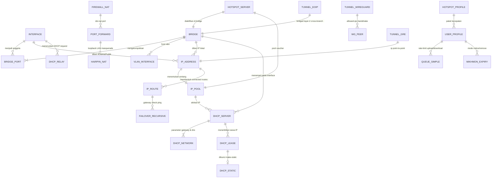

# 🗺️ Panduan Arsitektur & Relasi Antar Entitas Jaringan MikroTik RouterOS

> **Dokumen Panduan Pengembang (Frontend & Backend Developer Guide)**  
> **Versi**: 1.0.0 Enterprise | **RouterOS**: v6.4x & v7.x Supported  
> **Tujuan**: Menjelaskan alur data, ketergantungan (dependencies), hierarki konfigurasi, dan relasi antar halaman (Page-to-Page Entity Relationships) dalam ekosistem RouterOS Gateway.

---

## 📌 Daftar Isi
1. [Prinsip Arsitektur: Bagaimana Jaringan MikroTik Bekerja](#1-prinsip-arsitektur)
2. [Diagram Relasi Entitas Global (Network Entity Relationship Map)](#2-diagram-relasi-entitas-global)
3. [Detail Relasi Entitas per Sub-Sistem](#3-detail-relasi-entitas-per-sub-sistem)
   - [A. Layer Fisik & L2 Switching: Interface, Bridge & VLAN](#a-layer-fisik--l2-switching)
   - [B. Layer 3 Addressing: IP Address, IP Pool & ARP](#b-layer-3-addressing)
   - [C. DHCP Suite: Server, Static Leases, Networks & DHCP Relay](#c-dhcp-suite)
   - [D. Enterprise IPv6: Addresses, Pools, DHCPv6 & ND](#d-enterprise-ipv6)
   - [E. Routing Engine: Static, Recursive Failover, PBR Mangle, BGP & OSPF](#e-routing-engine)
   - [F. Firewall & NAT: Masquerade, Port Forwarding (Dst-NAT) & Hairpin NAT](#f-firewall--nat)
   - [G. Site-to-Site & Remote Access Tunneling (WireGuard, GRE, IPIP, EoIP, SSTP, L2TP, OVPN)](#g-tunneling--vpn)
   - [H. Hotspot, User Manager, Mikhmon v4 & Bandwidth Shaping (Queues)](#h-hotspot-billing--queues)
4. [Matrix Navigasi & Ketergantungan UI (Page Dependency Graph)](#4-matrix-navigasi--ketergantungan-ui)
5. [Panduan REST API & Real-Time WebSocket untuk Developer](#5-panduan-rest-api--websocket)

---

## 1. Prinsip Arsitektur

Dalam RouterOS MikroTik, tidak ada konfigurasi yang berdiri sendiri (*no isolated configuration*). Setiap konfigurasi adalah rantai ketergantungan (*dependency chain*).

```
[Port Fisik / Wireless] 
       │
       ▼
[Bridge / VLAN (L2)] 
       │
       ▼
[IP Address & Subnet (L3)] 
       │
       ├─────────────────────────┬─────────────────────────┐
       ▼                         ▼                         ▼
  [IP Pool]               [Routing Table]             [Firewall NAT]
       │                         │                         │
       ▼                         ▼                         ▼
[DHCP Server / Relay]     [Gateway ISP]              [Masquerade & Dst-NAT]
       │
       ▼
[DHCP Leases (Klien)] ───► [Hotspot / Queue] ───► [Bandwidth Shaper]
```

---

## 2. Diagram Relasi Entitas Global



---

## 3. Detail Relasi Entitas per Sub-Sistem

### A. Layer Fisik & L2 Switching
- **Entitas**: `Ethernet`, `SFP`, `WLAN`, `Bridge`, `Bridge Port`, `VLAN`.
- **Relasi**:
  1. Port fisik (contoh: `ether2`, `ether3`, `ether4`, `wlan1`) tidak boleh diberi IP address terpisah jika ingin berada dalam 1 jaringan lokal.
  2. Kumpulan port tersebut dimasukkan ke dalam `Bridge` (`/interface/bridge/port/add`).
  3. `Bridge` bertindak sebagai Virtual Switch software-accelerated.
  4. Untuk segmentasi departemen/tenant, buat `VLAN` (`/interface/vlan/add interface=bridge vlan-id=10`).
- **Endpoint Terkait**:
  - `GET /api/v1/bridge/all`
  - `POST /api/v1/bridge/port/add`
  - `POST /api/v1/bridge/vlan/add`

---

### B. Layer 3 Addressing
- **Entitas**: `IP Address`, `IP Pool`, `ARP Table`.
- **Relasi**:
  1. `IP Address` (`/ip/address/add address=192.168.88.1/24 interface=bridge`) menetapkan identitas Layer 3 pada router dan otomatis membuat rute dinamis (DAC: Direct Active Connected) di tabel routing.
  2. `IP Pool` (`/ip/pool/add name=dhcp-pool ranges=192.168.88.10-192.168.88.254`) WAJIB berada dalam rentang subnet IP Address di atas.
  3. `ARP Table` mencatat pemetaan Layer 2 MAC Address ke Layer 3 IP Address secara dinamis atau statis (`Reply-Only` mode pada Bridge untuk mencegah IP liar).
- **Endpoint Terkait**:
  - `GET/POST /api/v1/ip/addresses` & `POST /api/v1/ip/address/add`
  - `GET/POST /api/v1/ip/pools` & `GET /api/v1/ip/pools/utilization`
  - `GET/POST /api/v1/ip/arp` & `POST /api/v1/ip/arp/add`

---

### C. DHCP Suite: Server, Static Leases, Networks & Relay
- **Entitas**: `DHCP Server`, `DHCP Network`, `DHCP Lease`, `DHCP Alert`, `DHCP Relay`, `DHCP Client`.
- **Relasi**:
  1. **DHCP Server**: Dihubungkan ke `interface` (misal `bridge`) dan mengonsumsi `address-pool` yang telah dibuat.
  2. **DHCP Network**: Berisi opsi DHCP Option 3 (Gateway: `192.168.88.1`), Option 6 (DNS: `192.168.88.1, 1.1.1.1`), dan Domain Name.
  3. **DHCP Leases**: Menyimpan data sewa dinamis klien (`address`, `mac-address`, `host-name`, `status=bound`).
  4. **Make Static (DHCP Reservation)**: Mengubah sewa dinamis menjadi statis permanen (`POST /api/v1/dhcp/lease/make-static`), sangat vital untuk printer kantor, NAS, server, CCTV.
  5. **DHCP Relay**: Digunakan jika router cabang TIDAK menjalankan DHCP Server sendiri, melainkan meneruskan request broadcast klien ke server DHCP pusat di kantor pusat (`POST /api/v1/dhcp/relay/add`).
  6. **Rogue DHCP Alert**: Memonitor adanya router wifi nakal milik karyawan yang menyebarkan IP salah di jaringan (`POST /api/v1/dhcp/alert/add`).
- **Endpoint Terkait**:
  - `POST /api/v1/dhcp/server/add` & `POST /api/v1/dhcp/server/set`
  - `GET/POST /api/v1/dhcp/leases` & `POST /api/v1/dhcp/lease/make-static`
  - `GET/POST /api/v1/dhcp/relays` & `POST /api/v1/dhcp/relay/add`
  - `GET/POST /api/v1/ip/dhcp-client/all` & `POST /api/v1/ip/dhcp-client/add`

---

### D. Enterprise IPv6
- **Entitas**: `IPv6 Address`, `IPv6 Pool`, `DHCPv6 Client`, `DHCPv6 Server`, `ND (Neighbor Discovery)`.
- **Relasi**:
  1. **DHCPv6 Client** di interface WAN meminta Prefix Delegation (`/56` atau `/64`) dari ISP (`POST /api/v1/ipv6/dhcp-client/add pool_name=isp-ipv6-pool`).
  2. Prefix tersebut otomatis mengisi `IPv6 Pool`.
  3. **IPv6 Address** pada interface LAN mengambil alamat dari pool tersebut (`from-pool=isp-ipv6-pool advertise=yes`).
  4. **Neighbor Discovery (ND)** mengirimkan Router Advertisement (RA) ke smartphone/laptop klien LAN sehingga klien mendapatkan IPv6 publik secara otomatis (SLAAC - Stateless Address Autoconfiguration).
  5. **DHCPv6 Server** melayani klien yang membutuhkan konfigurasi DNS & domain IPv6 stateful.
- **Endpoint Terkait**:
  - `GET/POST /api/v1/ipv6/addresses` & `POST /api/v1/ipv6/address/add`
  - `GET/POST /api/v1/ipv6/routes` & `POST /api/v1/ipv6/route/add`
  - `GET/POST /api/v1/ipv6/dhcp-client` & `POST /api/v1/ipv6/dhcp-client/add`
  - `GET/POST /api/v1/ipv6/dhcp-server` & `POST /api/v1/ipv6/dhcp-server/add`

---

### E. Routing Engine
- **Entitas**: `Static Route`, `Recursive Gateway Failover`, `Policy Based Routing (Mangle)`, `BGP`, `OSPF`.
- **Relasi**:
  1. **Default Gateway**: `dst-address=0.0.0.0/0 gateway=<IP_ISP>`.
  2. **Recursive Failover (MTCRE)**: Gateway tidak diarahkan ke IP modem (yang sering kali tetap UP walau internet putus), melainkan ke Public DNS (`8.8.8.8` & `1.1.1.1`) menggunakan `scope=10` dan `target-scope=11` dengan `check-gateway=ping`.
  3. **PBR / Multi-WAN Load Balancing**: Mangle `mark-routing` menandai koneksi, lalu tabel routing khusus (`routing-mark=to-WAN2`) mengarahkan traffic tersebut ke gateway ISP 2.
  4. **BGP & OSPF**: Dynamic Routing untuk bertukar tabel prefix ribuan rute secara otomatis antar router core data center.
- **Endpoint Terkait**:
  - `GET/POST /api/v1/ip/routes` & `POST /api/v1/ip/route/add`
  - `POST /api/v1/routing/failover/setup` & `GET /api/v1/routing/failover/status`
  - `GET/POST /api/v1/routing/bgp/sessions` & `GET/POST /api/v1/routing/ospf/neighbors`

---

### F. Firewall & NAT: Port Forwarding & Hairpin NAT
- **Entitas**: `Filter Rules (Forward/Input)`, `Src-NAT (Masquerade)`, `Dst-NAT (Port Forward)`, `Hairpin NAT`.
- **Relasi & Masalah Loopback LAN**:
  1. **Akses Internet Keluar**: Membutuhkan `Src-NAT action=masquerade out-interface=WAN`.
  2. **Akses Server dari Luar (Dst-NAT)**: Membuka port publik (misal 8080) dan meneruskannya ke IP lokal internal (192.168.88.50:80). Firewall Filter chain `forward` harus diizinkan (`accept`).
  3. **Masalah Hairpin NAT**:
     - Jika HP/Laptop di LAN (`192.168.88.100`) membuka domain DDNS atau IP Publik router untuk mengakses server lokal (`192.168.88.50`), paket akan macet (koneksi timeout) karena server merespons langsung via switch tanpa melewati router!
     - **Solusi Hairpin NAT**: Gateway secara otomatis menambahkan aturan `srcnat` loopback:
       `chain=srcnat src-address=192.168.88.0/24 dst-address=192.168.88.50 protocol=tcp dst-port=80 action=masquerade`.
       Dengan aturan ini, router menyamarkan IP HP menjadi IP router, memaksa balasan server kembali melewati router, sehingga koneksi berhasil 100%.
- **Endpoint Terkait**:
  - `POST /api/v1/firewall/port-forward` (dengan flag `"enable_hairpin": true`)
  - `POST /api/v1/firewall/hairpin-nat` (konfigurasi mandiri)
  - `POST /api/v1/firewall/srcnat/masquerade`

---

### G. Tunneling & VPN
- **Entitas**: `WireGuard`, `GRE`, `IPIP`, `EoIP`, `SSTP`, `L2TP/IPsec`, `OpenVPN`.
- **Tabel Karakteristik & Relasi**:
  | Protokol | Layer OSI | Enkripsi | Kebutuhan Relasi | Skenario Penggunaan |
  |---|---|---|---|---|
  | **WireGuard** | Layer 3 | Modern ChaCha20 | UDP Port, Public/Private Key, AllowedIPs | Interkoneksi modern v7 super cepat & hemat CPU |
  | **EoIP** | Layer 2 | None / IPsec Secret | Tunnel ID, Remote IP, di-Bridge ke LAN | Bridging L2 antar pulau (1 subnet sama) |
  | **GRE** | Layer 3 | IPsec Secret (Opsional) | Remote IP, IP point-to-point /30 | Standar Cisco/MikroTik interkoneksi WAN |
  | **IPIP** | Layer 3 | IPsec Secret (Opsional) | Remote IP, IP point-to-point /30 | Tunneling paling ringan (overhead paket minimal) |
  | **SSTP** | Layer 3 | TLS/SSL (TCP 443) | PPP Profile, PPP Secret, Port 443 | Tembus blokir ISP / hotel / firewall ketat |
  | **L2TP/IPsec** | Layer 3 | IPsec PSK / AES | PPP Profile, PPP Secret, IPsec Secret | Kompatibel native bawaan Android/iOS/Windows |

---

### H. Hotspot, Billing & Queues
- **Entitas**: `Hotspot Server`, `User Profile`, `Hotspot Users / Vouchers`, `Active Users`, `Hosts`, `Walled Garden`, `Simple Queue`, `Mikhmon v4`.
- **Relasi & Lifecycle Transaksi**:
  1. Klien belum login terdeteksi di `/api/v1/hotspot/hosts`. Traffic HTTP diarahkan ke Captive Portal (`login.html`).
  2. Domain payment gateway (Midtrans, Xendit, QRIS) didaftarkan di `/api/v1/hotspot/walled-garden/add` agar bisa dibuka sebelum bayar.
  3. Klien memasukkan voucher -> RouterOS memvalidasi ke `Hotspot User`.
  4. Akun aktif tercatat di `/api/v1/hotspot/active`.
  5. Kecepatan klien dibatasi otomatis oleh `User Profile` (Rate-Limit: `5M/5M`) yang membentuk aturan dinamis di `Simple Queue`.
  6. **Mikhmon v4 Auto-Lock MAC**: Script otomatis mengikat MAC HP klien ke voucher agar voucher tidak bisa dipakai orang lain.
  7. **Mikhmon v4 Expiry Mode**: Jika masa aktif habis (1 hari), router otomatis memutus user atau mengalihkannya ke halaman peringatan perpanjangan isolir.

---

## 4. Matrix Navigasi & Ketergantungan UI

Bagi pengembang Frontend (React / Vue / Next.js / Flutter), berikut adalah panduan pembuatan alur halaman:

```
[Dashboard NOC]
      │
      ├──► [Halaman Interfaces]
      │          └──► Button: "Jadikan Bridge Port" ──► Pindah ke [Halaman Bridge]
      │
      ├──► [Halaman IP Addressing]
      │          ├──► Step 1: Pasang IP Address pada Interface/Bridge
      │          ├──► Step 2: Buat IP Pool berdasarkan subnet di Step 1
      │          └──► Step 3: Buat DHCP Server mengacu ke Interface & IP Pool di atas
      │
      ├──► [Halaman Port Forwarding (NAT)]
      │          ├──► Input: Port Asal (8080) & IP Target (192.168.88.50)
      │          └──► Switch Toggle: "Aktifkan Hairpin NAT (Akses dari dalam LAN)"
      │
      ├──► [Halaman Tunneling & VPN]
      │          ├──► Tab 1: WireGuard (v7 Fast Tunnel)
      │          ├──► Tab 2: GRE & IPIP (Site-to-Site L3)
      │          └──► Tab 3: EoIP (Layer-2 Bridging)
      │
      └──► [Halaman Hotspot & Billing Mikhmon]
                 ├──► Tab 1: Voucher Generator (Batch Print Thermal)
                 ├──► Tab 2: User Profiles & Bandwidth Limits
                 └──► Tab 3: Live Active Sessions & Kick Action
```

---

## 5. Panduan REST API & WebSocket

### Headers Wajib untuk Multi-Router Management
Setiap request HTTP REST API dapat mengontrol router mana pun dengan mengirim header:
```http
Authorization: Bearer <TOKEN>
X-Router-Host: 192.168.88.1
X-Router-Port: 8728
X-Router-User: admin
X-Router-Pass: rahasia123
```

### WebSocket Real-time Endpoint
Untuk grafik realtime lalu lintas, ping telemetri, dan log streaming tanpa polling HTTP:
```javascript
// Hubungkan WebSocket ke Gateway
const ws = new WebSocket("ws://127.0.0.1:8080/ws");

ws.onopen = () => {
  // 1. Kirim autentikasi target router
  ws.send(JSON.stringify({
    action: "auth",
    token: "valid-jwt-token",
    router: {
      host: "192.168.88.1",
      port: 8728,
      user: "admin",
      pass: "rahasia123"
    }
  }));

  // 2. Langganan live bandwidth interface WAN
  ws.send(JSON.stringify({
    action: "subscribe_traffic",
    interface: "ether1"
  }));

  // 3. Langganan dashboard telemetri (CPU, Memory, Active Users) setiap 1 detik
  ws.send(JSON.stringify({
    action: "subscribe_overview",
    interval_ms: 1000
  }));
};

ws.onmessage = (event) => {
  const frame = JSON.parse(event.data);
  console.log("Real-time Frame:", frame);
  // Update grafik Chart.js / Flutter widget secara mulus (<1.5 ms latency)
};
```
